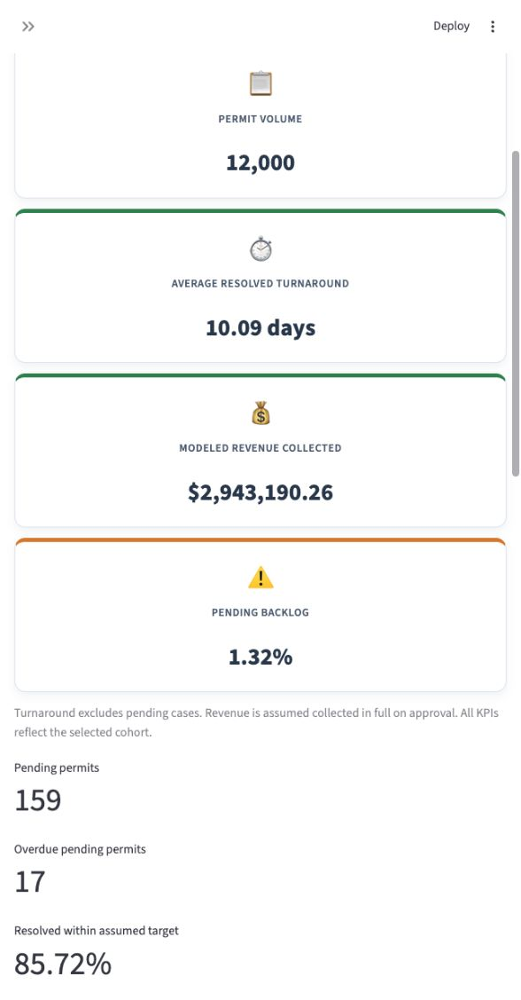
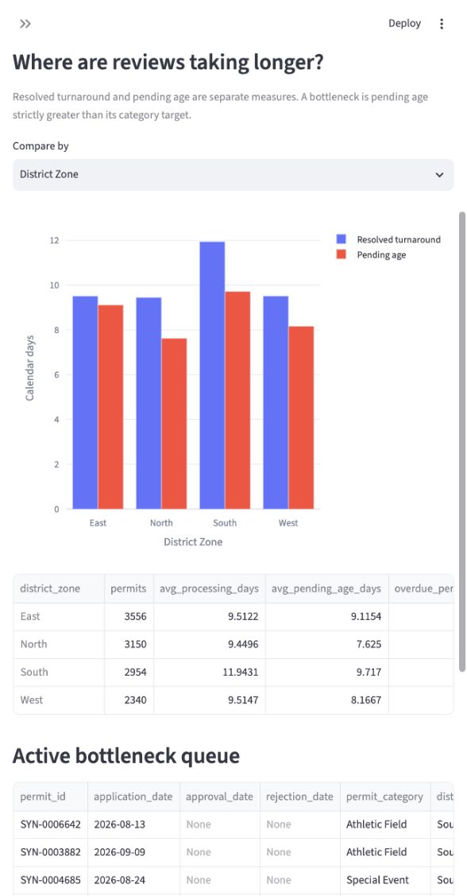
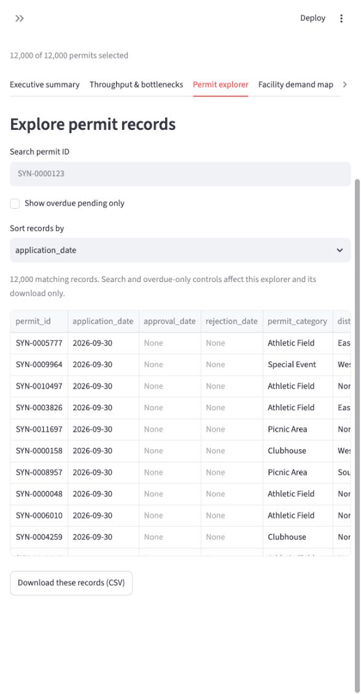
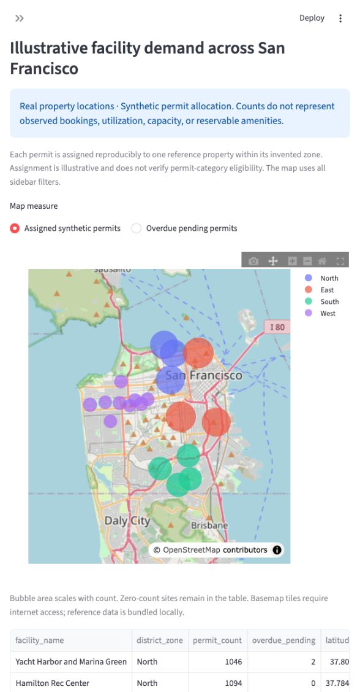

# SF Rec Park Permits & Reservations Analytics


[](#streamlit-community-cloud)
[](LICENSE)

## Executive summary

A reproducible municipal analytics portfolio built with Python, Pandas, SQLite,
Streamlit, and Plotly. It demonstrates validated permit intake data, calendar-day
turnaround measures, overdue queue monitoring, revenue summaries, and geospatial
exploration for public sector analysts.

**All permit transactions are synthetic.** Facility names and coordinates are
sourced from DataSF. This is an independent portfolio project, not an official
City application or assessment of SF Rec Park performance.

[Read the nine-page project report](reports/sf_rec_park_project_report.pdf), with a
clickable table of contents, computed results, limitations, recommendations, and
all 19 reference properties. The report opening follows the supplied portfolio
reference: navy cover border, serif title, blue section headings, and KPI tiles.

### Snapshot results

| Measure | Synthetic result |
| --- | ---: |
| Observation cutoff | September 30, 2026 |
| Permit applications | 12,000 |
| Resolved applications | 11,841 |
| Approved / rejected | 10,355 / 1,486 |
| Average resolved turnaround | 10.09 calendar days |
| Modeled collected revenue | $2,943,190.26 |
| Pending permits | 159 |
| Backlog percentage | 1.325% |
| Overdue pending permits | 17 |
| Historical late decisions | 1,691 |
| Resolved within assumed target | 85.72% |

These results come from the committed SQLite snapshot. Run `python etl.py` to
recalculate them. Dashboard filters create application cohorts; filtered figures
will differ from these full-snapshot results.

## Project motivation

Public service engagement and rideshare conversations with residents and visitors
inspire questions about access to San Francisco's neighborhoods and public spaces.
This project connects that urban perspective with administrative analysis: clear
service measures, auditable records, and understandable reporting. Those informal
observations motivate the project; they are not a representative demand survey.

The work supports an 1820 Junior Administrative Analyst portfolio by demonstrating
SQL analysis, data validation, workflow measurement, and communication of evidence
and limitations.

## Data limitations and architecture

DataSF's public property inventory supplies authentic municipal geography. No
internal transaction queue, applicant information, reviewer event log, or portal
monitoring feed was obtained for this project. Whether particular administrative
fields are publicly available or legally restricted has not been established;
field-specific disclosure claims require authoritative verification.

Synthetic records make the demonstration reproducible without applicant data.
Their fees, category mix, approval rates, intake seasonality, review times, targets,
and four analytical zones are assumptions. Longer event reviews and an assumed
South-zone delay multiplier are built into the generator. Recovering those effects
is a demonstration, not an empirical finding about the department.

```text
data_generator.py -> data/permits.csv -> etl.py -> data/permits.sqlite
                                                      |
appendix_data.py (public properties) ----------------> app.py
                                                      |
                                         generate_report.py -> reports/
```

The dashboard adds a reproducible synthetic facility assignment after reading
SQLite. It hashes each permit ID into a sorted property pool within the invented
zone. Assignment version: `zone-sha256-v1`. Counts and revenue reconcile, but this
does not establish actual bookings, category eligibility, occupancy, capacity, or
utilization. Changing the reference pool changes assignments.

See [data sources and provenance](DATA_SOURCES.md), the preserved
[source excerpt](data/facility_source_excerpt.json), and the
[facility reference CSV](data/facility_reference.csv). The 19-property subset
includes recreation centers, Marina Green, McLaren Park, and Golden Gate Park's
seven source inventory sections. Property points are not verified entrances.

## Methodology and ETL pipeline

1. Generate fictional transactions with a seed and fixed snapshot date. The
   manifest records generator parameters and NumPy/Pandas versions.
2. Validate schema, dates, IDs, statuses, zones, integer fees, and positive targets.
   Reject invalid inputs rather than silently removing rows.
3. Calculate resolved turnaround separately from pending age and flag active
   overdue applications. Validate modeled full payment on approval.
4. Build a complete temporary SQLite database and replace the prior snapshot only
   after success. Repeat loads do not append duplicates.
5. Read SQLite in read-only snapshot transactions. Each dashboard interaction
   rereads the database so refreshed ETL results are not hidden behind a cache.

| Measure | Definition |
| --- | --- |
| Resolved turnaround | Decision date minus application date, calendar days |
| Pending age | Snapshot date minus application date, pending records only |
| Backlog percentage | Pending / all selected permits x 100 |
| Active bottleneck | Pending age strictly greater than its category target |
| Historical late decision | Resolved turnaround strictly greater than target |
| Within-target compliance | Resolved on/before target / resolved permits x 100 |
| Collected revenue | Integer US cents, assumed paid in full on approval |
| Undefined denominator | SQL NULL and dashboard N/A |

Exactly-on-target cases are compliant. Pending records have no future decision
dates. Resolved-only averages are subject to snapshot censoring and can understate
eventual turnaround for recent cohorts. Revenue excludes refunds, waivers, partial
payments, and accounting adjustments.

### SQLite objects

`permits` stores validated records and derived fields. `etl_metadata` stores the
snapshot, schema version, input SHA-256, and bottleneck rule. Views include
`executive_kpis`, `category_kpis`, `zone_kpis`, `category_zone_kpis`,
`monthly_throughput`, and `bottleneck_applications`.

```sql
SELECT * FROM executive_kpis;
SELECT * FROM category_kpis ORDER BY avg_processing_days DESC;
SELECT * FROM bottleneck_applications ORDER BY days_over_target DESC;
SELECT * FROM monthly_throughput ORDER BY decision_month;
```

## Key visuals and dashboard walkthrough

### Executive summary

Icon cards show selected volume, resolved turnaround, full-precision revenue, and
pending backlog. Charts show status counts, category revenue, and decisions by
month. Monthly decisions belong to the selected application cohort.



### Throughput and bottlenecks

Compare completed turnaround with pending age by category or zone. Inspect the
overdue queue, sorted by days over target, and download the selected records.



### Filterable permit explorer

Apply shared application-date, category, zone, and status filters. Search literal
permit IDs, show overdue pending only, sort records, and export CSV. Search and
overdue-only controls affect the explorer only. An unmatched search displays a
warning; empty sidebar selections return no records.



### Facility demand map

Bubble area represents assigned synthetic permits or overdue pending cases.
Hover for property details. Zero-count reference sites remain in the table and
CSV download. Basemap tiles require internet; reference tables work locally.



Screenshots capture the dashboard's responsive narrow layout. Wider screens place
executive cards in columns. They are reference captures, not a live data feed.

## SLA framework and governance

The implemented baseline is **service-category-based and uses calendar days**:
athletic fields 14, picnic areas 10, clubhouses 21, and special events 30. These are
portfolio assumptions, not verified departmental commitments.

The proposed customer-based framework would add customer-profile differentiation
and baseline layering. Proposed priorities are:

| Priority | Proposed initial response | Proposed resolution |
| --- | --- | --- |
| P1: special events / urgent | 4 business hours | 5 business days |
| P2: athletic fields | 24 business hours | 10 business days |
| P3: picnic / general | 48 business hours | 15 business days |

Other proposed objectives are a 3% backlog ceiling, a 14-day stale threshold, and
99.9% portal uptime. They are displayed as future design objectives. They do not
replace the current category targets or establish measured compliance.

Implementation would require applicant/customer profiles, priority and clubhouse
mappings, response timestamps, business-hour and holiday calendars, exception
rules, accountable metric owners, and independent availability monitoring. A
priority label alone does not create customer-based governance.

## Installation and local execution

Use Python 3.11 or 3.12. From the permanent workspace:

```sh
cd /Users/sileshihirpa/Desktop/ASU/projects/sf-rec-park-analytics
python3 -m venv .venv
source .venv/bin/activate
python -m pip install -r requirements.txt
python etl.py
streamlit run app.py
```

Open http://localhost:8501. The repository includes the synthetic CSV and SQLite
snapshot, so regeneration is optional. To create a different modeled dataset:

```sh
python data_generator.py --rows 12000 --seed 1820 --start 2025-01-01 --as-of 2026-09-30
python etl.py
```

For exact generator reproduction, use the NumPy/Pandas versions recorded in
`data/permits.manifest.json`. Requirements allow compatible updates; the committed
snapshot remains the portfolio reference.

Custom ETL paths:

```sh
python etl.py --input data/permits.csv --database data/permits.sqlite
```

`app.py` and `generate_report.py` resolve their default database relative to their
own location. `PERMITS_DATABASE` selects another database for the dashboard. The
generator and ETL command defaults use the current directory, so run them from
repository root. A missing database shows setup guidance rather than creating an
empty file.

### Tests and PDF rebuild

```sh
python -m pip install -r requirements-report.txt
python -m unittest discover -s tests -v
python generate_report.py
```

The report writes to `reports/sf_rec_park_project_report.pdf`. Optional arguments
include `--database`, `--output`, `--author`, and `--date` (ISO format). Its report
date defaults to October 23, 2026 and its observation cutoff comes from SQLite.
Contents links and PDF bookmarks point to the final section pages. Generation
fails on template overflow rather than silently clipping content.

### Docker

With Docker Engine and the Compose plugin installed:

```sh
docker compose up --build
```

Open http://localhost:8501. Compose binds the dashboard to the local loopback
interface. The container runs as a non-root user, loads the committed synthetic
snapshot, and includes an HTTP health check. It has one service because SQLite is
an embedded database; a separate database service is unnecessary.

```sh
docker compose down
# Optional image-only route:
docker build -t sf-rec-park-analytics .
docker run --rm -p 127.0.0.1:8501:8501 sf-rec-park-analytics
```

Docker configuration is included but has not been executed in the authoring
environment because Docker is unavailable there.

### Streamlit Community Cloud

Cloud publication is pending. After publishing this repository to your own GitHub
account, create a Streamlit Community Cloud app, choose the repository and branch,
and set the entrypoint to `app.py`. The committed database and production
requirements are sufficient to start the dashboard without a cloud ETL job.
Replace the pending badge with the actual app link only after verifying deployment.
No secrets are needed for this demonstration. The supplied GitHub Actions workflow
runs tests on Python 3.11 and 3.12 and rebuilds the report; remote CI status remains
unverified until it runs in GitHub.

## Repository structure

```text
sf-rec-park-analytics/
├── .github/workflows/tests.yml
├── assets/screenshots/
├── data/
│   ├── permits.csv
│   ├── permits.sqlite
│   ├── permits.manifest.json
│   ├── facility_reference.csv
│   └── facility_source_excerpt.json
├── reports/sf_rec_park_project_report.pdf
├── tests/
│   ├── test_etl.py
│   ├── test_app.py
│   └── test_report.py
├── app.py
├── appendix_data.py
├── data_generator.py
├── etl.py
├── generate_report.py
├── requirements.txt
├── requirements-report.txt
├── Dockerfile
├── docker-compose.yml
├── .dockerignore
├── .gitignore
├── DATA_SOURCES.md
├── LICENSE
└── README.md
```

## Conclusions and recommendations

The platform demonstrates an auditable path from fictional administrative records
to SQL summaries, an interactive dashboard, and a linked project report. It makes
metric definitions explicit and separates active overdue queues from historical
late decisions.

For a real municipal pilot, standardize intake document checklists and response
events, establish baseline measures, agree on service-target governance, and
review overdue cases with operational context. Gather actual reservation slots,
closures, amenities, and occupancy before recommending dynamic capacity
allocation. Evaluate any process change against documented outcomes. This
simulation does not establish a percentage reduction in delays, a staffing need,
or a causal service improvement.
